# AgroApp — Arquitectura y flujos completos

AgroApp es una app Flutter (Android + web) **offline-first** con backend Supabase, que conecta al agricultor con el equipo técnico de AIDER. Este documento explica cómo está construida hoy y cómo viaja cada dato, desde que alguien toca un botón hasta que queda en PostgreSQL.

| | |
|---|---|
| Generado | 2026-10-11, rama `mockup`, commit `b20a9f8` |
| Método | Skill `architecture-blueprint-generator` (github/awesome-copilot) + lectura del código |
| Complementa a | [CONTEXT.md](CONTEXT.md) (producto y reglas de negocio) y [ESTADO_ACTUAL.md](ESTADO_ACTUAL.md) (estado y pendientes) |
| No contiene | Contraseñas, claves ni tokens |

> **Convención.** Todo sale de leer el código, no de ejecutarlo. Lo marcado como *(inferido)* es una deducción que no está escrita de forma explícita en el código.

## Cómo leer este documento

| Si necesitas... | Ve a |
|---|---|
| Entender el sistema en un minuto | [1. Resumen](#1-resumen) |
| Saber dónde va un archivo nuevo | [4. Estructura](#4-estructura-de-carpetas) y [16. Guía para una feature nueva](#16-guía-para-una-feature-nueva) |
| Entender por qué un registro no sube | [8. Offline-first](#8-offline-first-y-sincronización) |
| Seguir un flujo de usuario paso a paso | [9. Flujos por rol](#9-flujos-por-rol) |
| Entender permisos y tablas | [11. Backend Supabase](#11-backend-supabase) |
| Conocer los riesgos antes de tocar algo | [17. Deuda técnica y riesgos](#17-deuda-técnica-y-riesgos) |

---

## 1. Resumen

- **Un solo código Flutter, dos experiencias.** El agricultor ve una app de teléfono; técnico, supervisor y admin ven una consola de tres paneles en web o pantalla ancha.
- **La UI nunca habla con Supabase** para datos de agricultor y técnico. Lee y escribe en una réplica local (Drift/SQLite) a través de `LocalStore`.
- **`SyncEngine` es el único puente** con el backend para datos de dominio: sube lo pendiente y descarga lo nuevo.
- **Excepción deliberada:** administración y supervisión son *solo en línea* y usan sus propios servicios.
- **La seguridad vive en el servidor.** Todas las tablas tienen RLS; el cliente solo filtra por comodidad.
- **Arquitectura:** capas + MVVM (`ChangeNotifier`), inyección con `provider`, errores como `Result<T>`.

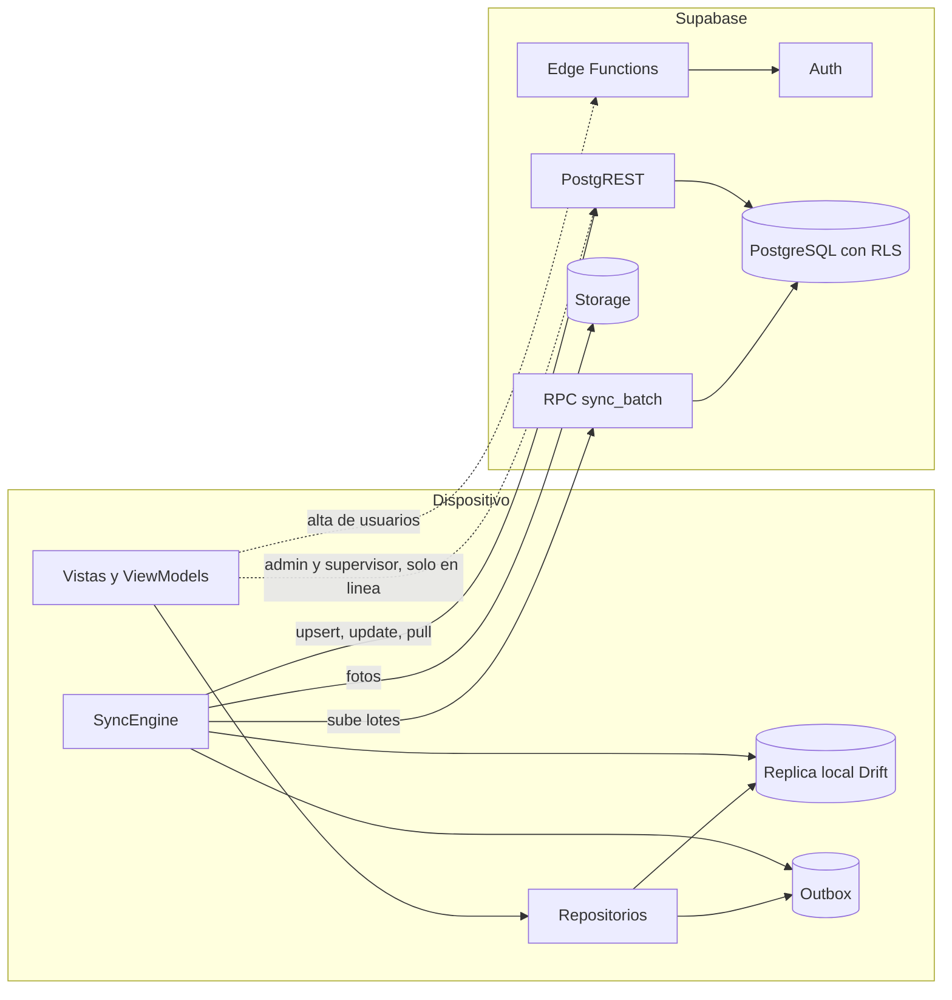

---

## 2. Stack tecnológico

| Capa | Tecnología | Uso |
|---|---|---|
| App | Flutter, Dart SDK `^3.10.7` | Android y web desde el mismo código |
| Estado e inyección | `provider` + `ChangeNotifier` | MVVM sin framework adicional |
| Base local | `drift` + `drift_flutter` (SQLite; WASM en web) | Réplica y cola de salida |
| Backend | `supabase_flutter` | Auth, PostgREST, RPC, Storage, Edge Functions |
| Mapa | `flutter_map` | Teselas satelitales por URL |
| Dispositivo | `geolocator`, `geocoding`, `image_picker`, `connectivity_plus`, `path_provider` | GPS, dirección, cámara, red, archivos |
| Identificadores | `uuid` | UUID v4 generado en el cliente |
| Servidor | PostgreSQL + RLS, Edge Functions en Deno | Reglas, permisos y alta de usuarios |
| Calidad | `flutter_lints`, `flutter_test`, `drift_dev`, `build_runner` | Lint, pruebas y código generado |

El paquete Dart se llama `hackathon`: los imports son `package:hackathon/...`.

---

## 3. Vista de capas

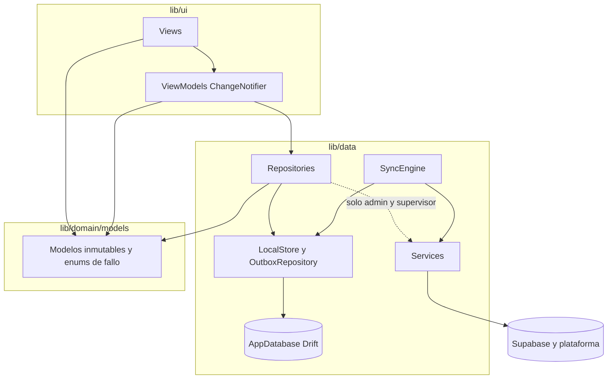

### Reglas de dependencia

| Regla | Detalle |
|---|---|
| La vista no tiene lógica | Solo layout y navegación. Recibe su ViewModel por constructor y se redibuja con `ListenableBuilder`. |
| El ViewModel no conoce Supabase | Recibe repositorios por constructor y devuelve `Result<T>` o `bool`. |
| El repositorio de agricultor y técnico solo toca `LocalStore` | Nunca ve un `SupabaseClient`. |
| El servicio no tiene estado | Envuelve lo externo: Supabase, cámara, GPS, conectividad. |
| Las excepciones no llegan a la UI | Se convierten en `Result.error` con un enum de fallo. |

### Interfaces y sus implementaciones

Cada dependencia externa está detrás de una interfaz para poder sustituirla en las pruebas.

| Interfaz | Implementación |
|---|---|
| `AuthService` | `SupabaseAuthService` |
| `SyncService` | `SupabaseSyncService` |
| `AdminService` | `SupabaseAdminService` |
| `SupervisorService` | `SupabaseSupervisorService` |
| `ConnectivityService` | `DeviceConnectivityService` |
| `PhotoService` | `DevicePhotoService` |
| `PlaceLookup` | `DevicePlaceLookup` |
| `LocationRepository` | `DeviceLocationRepository` |
| `AuthRepository` | `DefaultAuthRepository` |
| `SessionCache` | `DriftSessionCache` |
| `AdminRepository` | `DefaultAdminRepository` |
| `SupervisorRepository` | `SupabaseSupervisorRepository` |
| `Home`, `Parcel`, `Incident`, `Activity`, `Harvest`, `Assistance`, `TechnicianRepository` | `Local*Repository` |

Sin interfaz (clases concretas): `OutboxRepository`, `LocalStore`, `SyncEngine`, `CaseReader`.

### `Result<T>`

Definido en [lib/utils/result.dart](lib/utils/result.dart): una clase sellada con `Ok<T>(value)` y `Error<T>(Exception error)`. Como el error debe ser una `Exception`, los enums de fallo la implementan.

```dart
final result = await repository.addParcel(name: name, areaHectares: area, location: point);
switch (result) {
  case Ok():    // continuar
  case Error(): // mostrar el mensaje del enum de fallo
}
```

---

## 4. Estructura de carpetas

La UI se agrupa **por funcionalidad**; datos y dominio se agrupan **por tipo**.

```text
lib/
├── main.dart                 Inicializa Supabase y monta los providers
├── app.dart                  MaterialApp, AuthGate y el cableado por rol
├── config/
│   ├── dependencies.dart     Providers globales (un solo lugar)
│   ├── supabase_config.dart  URL y clave publicable
│   └── map_config.dart       Teselas, zoom y centro por defecto
├── utils/result.dart         Result<T>
├── domain/models/            Modelos inmutables, enums y fallos
│   └── admin/                Definiciones de catálogos y usuarios
├── data/
│   ├── local/                AppDatabase y tablas Drift
│   ├── services/             Supabase, fotos, conectividad, direcciones
│   ├── repositories/         Reglas de datos; lo único que ve la UI
│   └── sync/                 SyncEngine y registro de tablas
└── ui/
    ├── core/theme/           AppTheme
    ├── core/widgets/         Componentes compartidos
    └── features/<feature>/   views/ + view_models/

supabase/
├── migrations/               01 a 17 (esquema, RLS, RPC, semilla)
└── functions/                admin-create-user, admin-manage-user

test/                         Refleja lib/, más test/testing/ con los fakes
scripts/create-admin.mjs      Alta del primer administrador
odd/tasks/                    Documentos de seguimiento por funcionalidad
```

Funcionalidades en `lib/ui/features/`: `welcome`, `login`, `auth`, `home`, `parcel`, `incident_report`, `activity_log`, `harvest`, `assistance`, `technician`, `supervisor`, `admin`, `console`, `staff_home` (sin uso, ver [17](#17-deuda-técnica-y-riesgos)).

---

## 5. Arranque de la aplicación

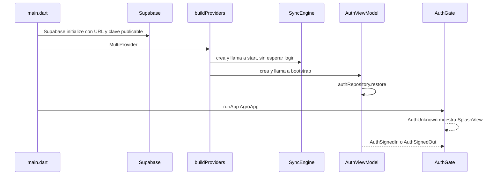

### Orden de los providers globales

Definidos en [lib/config/dependencies.dart](lib/config/dependencies.dart) (`buildProviders`):

1. `AppDatabase`
2. `AuthService`, `SyncService`, `PhotoService`, `ConnectivityService`
3. `LocationRepository`, `PlaceLookup`
4. `OutboxRepository` → `LocalStore`
5. `SyncEngine` (no perezoso: arranca al crearse)
6. `AdminService` → `AdminRepository`
7. `SupervisorService` → `SupervisorRepository`
8. `AuthRepository`
9. `AuthViewModel` (no perezoso: restaura la sesión al crearse)

### Repositorios por usuario

Los repositorios que dependen de **quién** inició sesión no están en `dependencies.dart`. Se crean en [lib/app.dart](lib/app.dart) cuando ya existe un usuario:

| Ámbito | Repositorios | Clave |
|---|---|---|
| Agricultor (`_FarmerHome`) | `Home`, `Parcel`, `Incident`, `Activity`, `Harvest`, `Assistance` | `farmerId` |
| Técnico (`_TechnicianScope`) | `Technician` y tres ViewModels | id del técnico |

---

## 6. Autenticación y sesión

### Identificador de acceso

Un solo campo "DNI o correo" ([login_identifier.dart](lib/domain/models/login_identifier.dart)):

| Entrada | Se interpreta como | Correo enviado a Supabase Auth |
|---|---|---|
| Contiene `@` y es un correo válido | Personal | El mismo, en minúsculas |
| Exactamente 8 dígitos | Agricultor (DNI) | `<dni>@agricultores.agroapp` |
| Cualquier otra cosa | Error | — |

Si el acceso fue por DNI se envía `farmerOnly: true`: un perfil que no sea agricultor se cierra y se informa como credenciales inválidas.

### Inicio de sesión

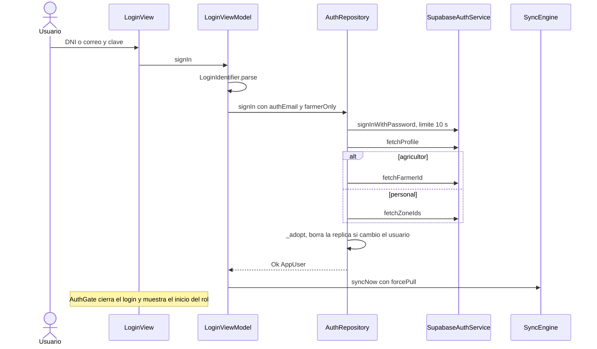

Validaciones en orden: formato del identificador → clave no vacía → credenciales → perfil existente → cuenta activa → `farmerId` (agricultor) o zonas (personal). Si algo falla después de autenticar, se cierra la sesión en silencio.

### Restaurar la sesión al abrir

1. `restoredUserId()` lee la sesión guardada **sin red**. Si no hay, el estado es "sin sesión".
2. Si hay, intenta cargar el perfil.
3. **Sin conexión** (`offline` o `unknown`): usa el perfil en caché (`session_user`) si coincide el id y está activo. Por eso la app abre sin señal.
4. **Cuenta inválida** (`inactiveAccount`, `noProfile`, `invalidCredentials`, `sessionExpired`): cierra la sesión y limpia la caché.

El primer inicio de sesión en un equipo siempre necesita conexión.

### Estados de sesión

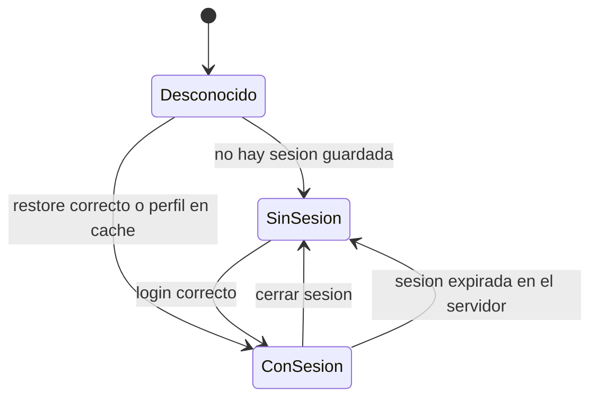

### Cerrar sesión

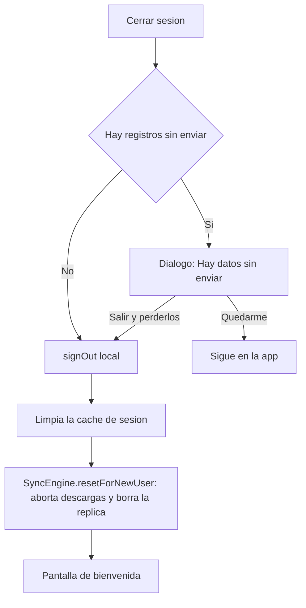

`clearAll()` borra réplica, outbox y cursores; conserva `device_id`.

Cuando la sesión **expira en el servidor**, se vuelve a la bienvenida con un aviso, pero la réplica y la caché **se conservan**.

### Clasificación de errores de autenticación

| Situación | `AuthFailure` |
|---|---|
| Error de red o tiempo agotado | `offline` |
| Correo o clave incorrectos | `invalidCredentials` |
| Perfil inexistente o rol desconocido | `noProfile` |
| Cuenta no activa | `inactiveAccount` |
| Error de PostgREST | `unknown` |

---

## 7. Navegación

No hay rutas con nombre ni `go_router`. Existe un único `MaterialApp(home: AuthGate)` y toda la navegación es imperativa (`Navigator.push`). Las pestañas son `IndexedStack` y los módulos de la consola cambian con `setState`.

El cableado de pantallas vive en [lib/app.dart](lib/app.dart): envoltorios privados `_XScreen` crean el ViewModel de cada pantalla.

### A dónde llega cada rol

Decisión en [auth_gate.dart](lib/ui/features/auth/views/auth_gate.dart). "Ancho" significa `kIsWeb` o ancho ≥ 900 px.

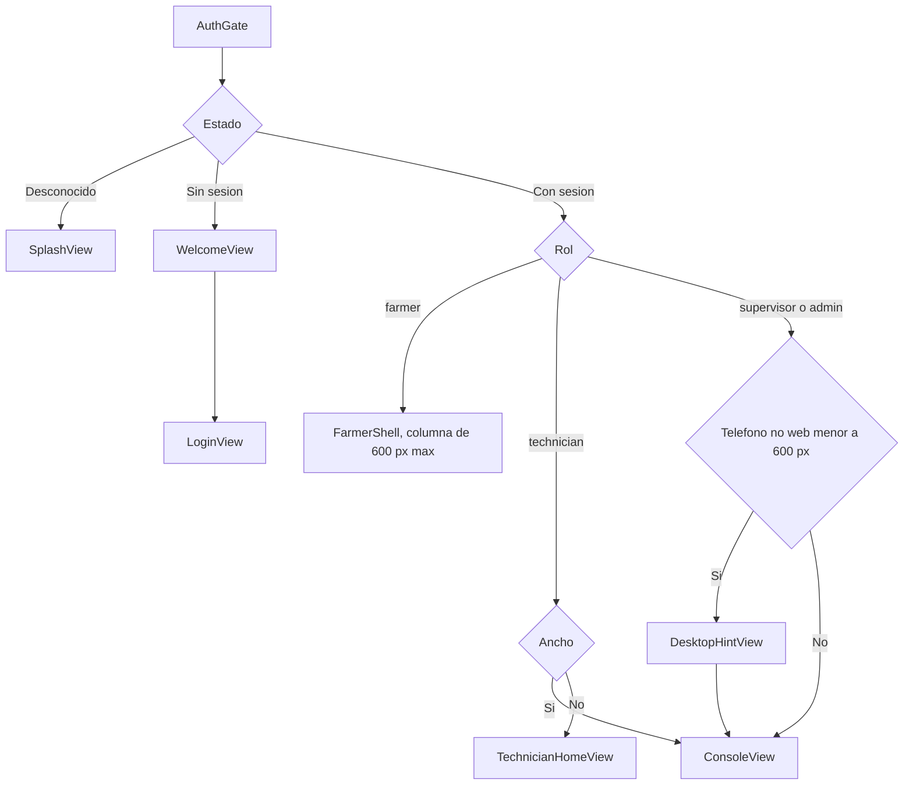

### Módulos de la consola por rol

Definidos en [console_modules.dart](lib/ui/features/console/console_modules.dart).

| Rol | Módulos |
|---|---|
| Técnico | Inicio, Agricultores, Alertas |
| Supervisor | Inicio, Territorio, Equipo, Reportes |
| Admin | Inicio, Parcelas, Territorio, Equipo, Reportes, Calendario, Administración, Alertas |

### Diseño de tres paneles

[three_panel_scaffold.dart](lib/ui/core/widgets/three_panel_scaffold.dart):

- **≥ 900 px:** barra lateral de 72 px + panel de lista opcional de 340 px + área principal.
- **< 900 px:** barra superior con un cajón que contiene la barra lateral y la lista.

---

## 8. Offline-first y sincronización

Esta es la parte más importante del sistema.

### 8.1 Almacenamiento local

`AppDatabase` ([app_database.dart](lib/data/local/app_database.dart)), archivo `agroapp`, `schemaVersion = 2`. Tres tablas:

| Tabla | Para qué | Columnas clave |
|---|---|---|
| `local_records` | Réplica **genérica** de todas las tablas del servidor | `table_name`, `id`, `data` (fila completa en JSON), `updatedAt`, `deletedAt`, `pending`. PK: (`table_name`, `id`) |
| `outbox` | Cola de escrituras por enviar | `id`, `table_name`, `payload`, `syncStatus`, `attempts`, `lastError`, `op`, `clientCreatedAt` |
| `app_settings` | Clave/valor del dispositivo | `device_id`, `session_user`, `pull_cursor:<tabla>` |

> **Decisión clave:** no hay una tabla Drift por cada tabla de Supabase. Todo se guarda como JSON en `local_records`. Agregar una tabla al sistema no requiere migrar la base local.

Las llaves compuestas se unen con `|`. La tabla de servidor `app_settings` también se replica, pero como filas de `local_records`: no tiene relación con la tabla Drift del mismo nombre.

### 8.2 Tipos de operación

| `SyncOp` | Cómo viaja | Tablas |
|---|---|---|
| `batch` | RPC `sync_batch`, inserción idempotente | Registros de solo-agregar (ver lista abajo) |
| `upsert` | PostgREST `upsert` | `parcels`, `crop_cycles`, registros editables |
| `update` | PostgREST `update().eq('id')` | Cambios de estado del técnico |

**Tablas por lote:** `activities`, `expenses`, `incidents`, `incident_photos`, `harvests`, `surplus_sales`, `residue_management`, `recommendation_confirmations`, `technical_assistance`, `assistance_documents`, `visit_attendance_confirmations`.

### 8.3 Camino de escritura

`LocalStore.save` ([local_store.dart:99](lib/data/repositories/local_store.dart)) intenta **primero el servidor** y usa la cola como respaldo. No consulta `connectivity_plus` porque en Android suele reportar "sin conexión" cuando HTTP sí funciona.

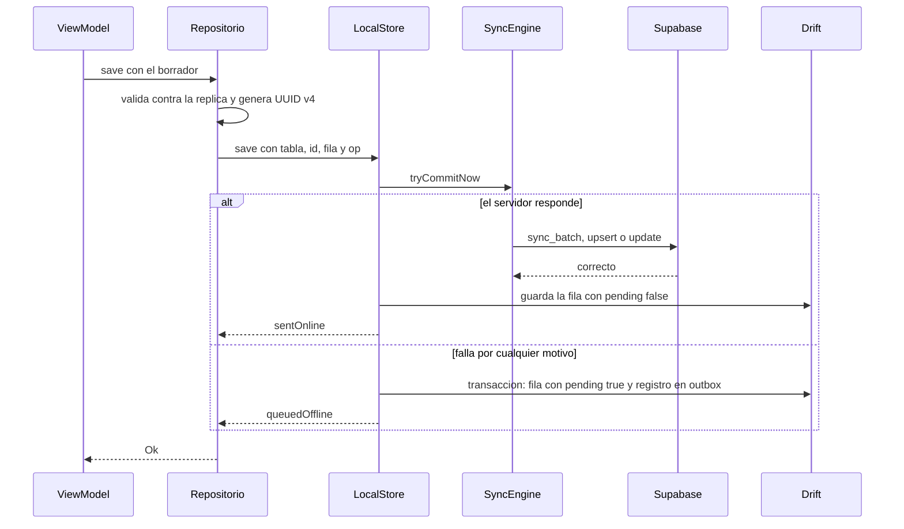

Detalles que importan:

- **Padres antes que hijos.** El repositorio guarda primero la incidencia y luego sus fotos.
- **Idempotencia.** El UUID del cliente es el id de la fila en el servidor. En `batch`, el id del outbox es el mismo id de la fila.
- **Contenido enviado.** En `update` van solo los campos cambiados más el id; en los demás va la fila completa fusionada.
- **Sin tiempo límite propio.** `save` espera la respuesta de red antes de escribir en local; un dispositivo realmente sin señal falla rápido y cae a la cola.

### 8.4 Subida en segundo plano

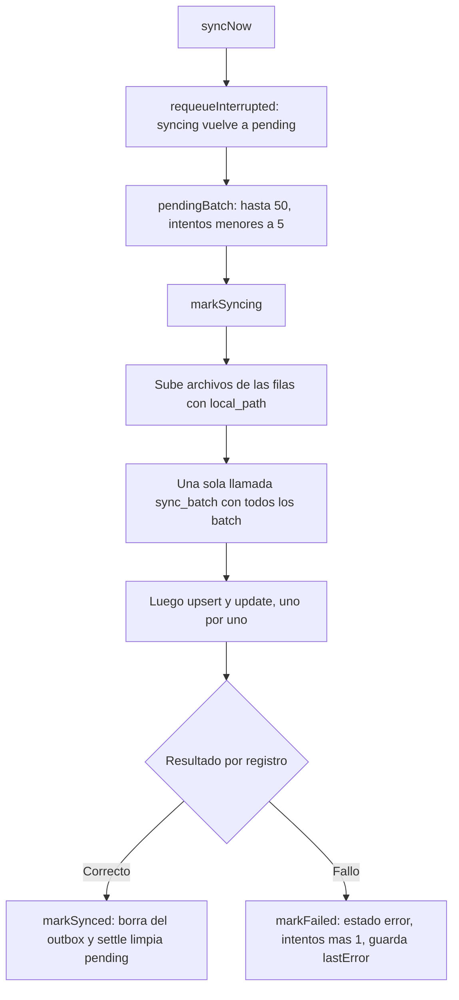

| Caso | Comportamiento |
|---|---|
| Un registro falla | No aborta el lote; solo ese queda en `error` |
| Falla el transporte del RPC | Todo el lote se marca como fallido |
| Id ausente en la respuesta | Se marca como "Record missing from the sync response" |
| 5 intentos fallidos | Se omite hasta `syncNow(retryFailed: true)` |
| App cerrada a mitad de envío | Los `syncing` vuelven a `pending` al iniciar |
| Registro entregado | Se **borra** del outbox; el estado `synced` nunca se persiste |

> **Riesgo de orden** *(inferido)*: los `batch` siempre salen antes que los `upsert` y `update` del mismo ciclo. Si una actividad en cola depende de una parcela o un ciclo también en cola, la actividad falla en ese ciclo y se reintenta en el siguiente.

### 8.5 Fotos y documentos

1. `DevicePhotoService` limita la imagen a 1280 px, calidad JPEG 80, y la copia a `<documentos>/incident_photos/<uuid>.jpg`.
2. La fila guarda `local_path` (ruta en el dispositivo) y `storage_path` (destino en Storage).
3. Al sincronizar, el motor sube el archivo con `upsert: true` y quita `local_path` de lo enviado.
4. Si la subida falla, solo falla ese registro.
5. El archivo local no se borra; la UI lo usa primero y, si no existe, pide una URL firmada (3600 s).

| Tipo | Bucket | Ruta |
|---|---|---|
| Foto de incidencia | `incidents` | `<farmerId>/incidents/<incidentId>/<photoId>.jpg` |
| Ficha de visita externa | `external-documents` | `<farmerId>/external-documents/<assistanceId>/<docId>.jpg` |

La primera carpeta siempre es el `farmerId`: de eso dependen las políticas de Storage.

### 8.6 Descarga (réplica)

`_pull` recorre las tablas de [sync_tables.dart](lib/data/sync/sync_tables.dart) en orden. Una tabla que falla se ignora y se reintenta en la siguiente descarga.

| Estrategia | Cómo funciona | Tablas |
|---|---|---|
| Incremental por cursor | `updated_at > cursor`, páginas de 1000, orden ascendente | Catálogos y tablas de dominio |
| Cursor distinto | Usa `changed_at` | `incident_status_history` |
| Reemplazo total | Descarga todo y reemplaza | `activity_type_units`, `product_units`, `crop_harvest_units`, `user_zones`, `technician_parcels` |
| No se replican | — | `audit_logs`, `sync_log`, `device_tokens` |

Reglas:

- **Lo local gana mientras esté pendiente.** `applyServerRows` omite los ids con `pending = true`.
- **Sin fusión de conflictos.** Los `upsert` son "gana la última escritura" *(inferido)*.
- **Borrados.** Se usa borrado lógico (`deleted_at`). Un borrado físico en el servidor solo se refleja en las tablas de reemplazo total *(inferido)*.
- **El alcance lo decide el servidor.** La descarga trae lo que RLS permite; el cliente no filtra por seguridad.

### 8.7 Qué dispara una sincronización

| Disparador | Llamada |
|---|---|
| Arranque del motor | `syncNow(forcePull: true)` |
| Temporizador cada 5 s | `syncNow()`; descarga si pasaron 30 s, si se subió algo o si se fuerza |
| Vuelve la conexión | `syncNow(retryFailed: true, forcePull: true)` |
| Inicio de sesión o restauración | `requestSync` |
| Botón "Enviar datos ahora" | `syncNow(retryFailed: true)` |
| Admin crea un usuario | `syncNow(forcePull: true)` |

Sin conexión y sin `retryFailed`, `syncNow` devuelve un informe vacío. Las llamadas simultáneas esperan a la que está en curso. El motor sigue activo aunque no haya sesión.

### 8.8 Cómo reacciona la UI a los datos

`watchDerived` ([replica_watch.dart](lib/data/repositories/replica_watch.dart)) se suscribe a varias tablas de la réplica y recalcula un modelo cuando cualquiera cambia. Las ejecuciones no se solapan y los errores no cierran el flujo.

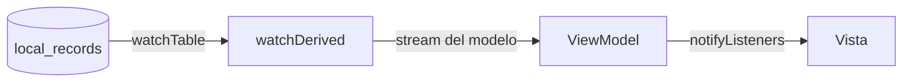

Lo que el usuario ve:

| Señal | Significado |
|---|---|
| Etiqueta "Por enviar" | La fila tiene `pending = true` |
| "Todo guardado" / "Enviando…" / "Hay datos por enviar" | Resumen del outbox |
| "Se guarda en su teléfono y se envía cuando haya señal." | Texto del paso de confirmación |

Los envíos fallidos se muestran como "pendientes" a propósito, para no alarmar al agricultor.

---

## 9. Flujos por rol

### 9.1 Agricultor

**Estructura.** `FarmerShell` con barra inferior: Inicio · Actividades · botón central "Reportar" · Reportes · Asistencias.

**Inicio.** Saludo, ícono de sincronización, acceso a la cuenta y tarjeta de la parcela. Dos páginas deslizables:

| Página | Contenido |
|---|---|
| Acciones | Actividad, Problema, Cosecha, Terreno, Calendario |
| Resumen | Último abonamiento, Próxima recomendación, Problema activo, Producción total |

#### Agregar un terreno

| Paso | Pantalla | Validación |
|---|---|---|
| 1 | Nombre | No vacío |
| 2 | Área en hectáreas | Mayor a 0; acepta `1,5` o `1.5` |
| 3 | Ubicación | Opcional. Toque en el mapa o "Usar mi ubicación" |
| 4 | Guardar | `ParcelRepository.addParcel` |

Al guardar se hace un `upsert` de `parcels` y se asegura un ciclo de cultivo activo (`ensureActiveCycle`, que prefiere Maíz). La zona se resuelve así: parcela propia → comunidad → primera zona. Si no hay zona aún, se muestra "Aún no tenemos su zona. Espere un momento con internet…".

La ubicación usa el último punto conocido si tiene menos de 2 minutos; si no, pide uno nuevo al GPS con límite de 20 s. La UI registra **un punto**, no dibuja polígonos (aunque los muestra si existen).

#### Reportar un problema

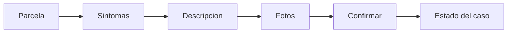

| Paso | Regla |
|---|---|
| Parcela | Se omite si solo hay una |
| Síntomas | Al menos uno; selección múltiple |
| Descripción | Opcional |
| Fotos | Opcional; máximo 3; cámara o galería |
| Confirmar | `IncidentRepository.submit` → "Guardado" → `CaseStatusView` |

Bloqueos previos: no tener parcela, o que el catálogo de síntomas aún no se haya descargado.

Datos escritos (todos `batch`): una fila en `incidents` con estado `reported` y prioridad `medium`, más una fila en `incident_photos` por foto. Solo el primer síntoma se guarda como tipo; los demás se agregan a la descripción.

#### Seguir un caso

`CaseStatusView` muestra la línea de tiempo (Reportado → En revisión → Visita programada → Atendido → Cerrado), fotos e historial.

| Acción del agricultor | Método | Tabla |
|---|---|---|
| "El técnico llegó" / "No llegó" | `confirmVisitAttendance` | `visit_attendance_confirmations` |
| "Ya lo hice" | `confirmRecommendation` | `recommendation_confirmations` |
| "Recordarme luego" | Solo muestra un aviso | — |

#### Registrar una actividad

Flujo de una pregunta por pantalla (`StepFlowScaffold`). El camino se calcula según el tipo elegido:

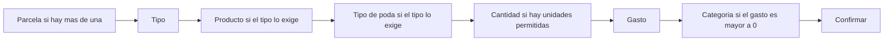

Cantidad y gasto son opcionales, pero deben ser mayores a 0 si se escriben. Se escribe una fila en `activities` y, si hubo gasto, una en `expenses` (moneda `PEN`).

Bloqueos: sin parcela, parcela sin ciclo de cultivo, catálogo no descargado.

#### Registrar una cosecha

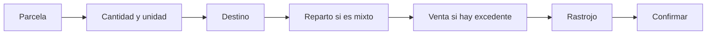

| Paso | Regla |
|---|---|
| Cantidad | Mayor a 0 y con unidad |
| Destino | Familia, Excedente, Mixto u Otro |
| Reparto | 0 < consumo del hogar < total |
| Venta | Opcional; precio mayor a 0 si se escribe |
| Rastrojo | Opcional: compost, otro uso, no aprovechado |

Escribe `harvests` y, según el caso, `surplus_sales` y `residue_management`.

#### Asistencias y visita externa

- **Lista y detalle:** proveedor (AIDER, SENASA, otra institución), estado, documentos por URL firmada y recomendaciones con casilla para confirmar.
- **Registrar visita externa:**

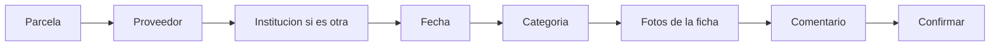

La fecha no puede ser futura. El agricultor **no puede** registrar asistencias de AIDER: lo rechazan el repositorio, el RPC y la política RLS.

#### Otras pantallas

| Pantalla | Contenido |
|---|---|
| Mis terrenos | Cuadrícula con insignias Revisar / Por enviar / Bien |
| Detalle del terreno | Mapa y tarjetas de nombre, área, cultivo, problemas abiertos, sincronización y ubicación |
| Calendario de abonamiento | Lista de solo lectura agrupada por mes |
| Mis actividades | Lista y detalle de solo lectura |
| Cuenta | Estado de sincronización, "Enviar datos ahora", "Cerrar sesión" |

### 9.2 Técnico

**En teléfono** (`TechnicianHomeView`): pestañas Inicio · Casos · Mapa · Agricultores.

**En consola:** Inicio (tablero), Alertas (lista + mapa de zona o detalle del caso) y Agricultores (lista + ficha).

**Tablero.** "Resumen de su zona" con: alertas abiertas, urgentes, visitas programadas, atendidos, cerrados, agricultores activos, recomendaciones confirmadas y tiempo medio de atención. Debajo, "Para atender hoy" (hasta 5 casos).

**Filtros de casos:** todos, urgentes, abiertos, programados, cerrados.

#### Acciones sobre un caso

| Acción | Condición | Datos | Método |
|---|---|---|---|
| Tomar caso | Estado `reported` | — | `takeCase` |
| Programar o reprogramar visita | Caso abierto | Fecha obligatoria, comentario opcional | `scheduleVisit` |
| Registrar asistencia | Caso abierto | Tipo y observación obligatorios; subtipo, recomendación y próxima revisión opcionales | `registerAssistance` |
| Dejar recomendación | Caso abierto | Texto obligatorio, fecha límite opcional | `addRecommendation` |
| Marcar atendido | No atendido aún | Comentario opcional | `markAttended` |
| Cerrar caso | Caso abierto | Comentario opcional | `closeCase` |
| Siguió / no siguió la indicación | Por recomendación | — | `markRecommendationFollowed` |

Tras cada acción: "Guardado en el dispositivo. Se enviará con conexión." Las escrituras del técnico usan `update` o `upsert`; las confirmaciones usan `batch`.

Cada cambio de estado escribe además una fila de historial **solo local** (`local-<incidentId>-<estado>`), que `CaseReader` combina con la que genera el disparador del servidor. Así el historial se ve de inmediato sin conexión.

#### Ciclo de vida de una incidencia

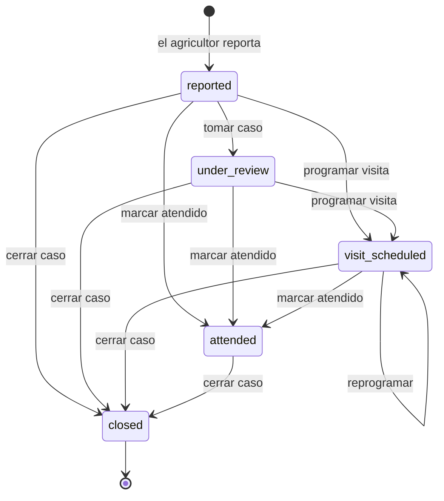

Las transiciones se validan **solo en el cliente** ([technician_repository.dart](lib/data/repositories/technician_repository.dart)): `takeCase` exige `reported` y ninguna acción acepta un caso `closed`. El servidor limita qué columnas puede cambiar el técnico, pero no qué transición hace.

#### Ficha del agricultor

Adopción de recomendaciones, última asistencia, parcelas, incidencias y asistencias. Desde aquí se registra una **asistencia en campo** sin incidencia asociada (`registerFieldAssistance`).

### 9.3 Supervisor

Solo lectura y **solo en línea**. `SupervisorRepository.loadDashboard()` lanza 8 consultas en paralelo y las agrega.

| Bloque | Contenido |
|---|---|
| Indicadores | Adopción, alertas resueltas, recomendaciones, tiempo de atención |
| Operación | Conteos por estado |
| Producción y gastos | Producción, autoconsumo y excedente por unidad; gastos |
| Carga por técnico | Distribución de asistencias y casos |

Filtro por zona en el panel de lista y botón "Actualizar". Fuentes: vistas `v_kpi_overview`, `v_zone_summary`, `v_recommendation_completion`, `v_crop_cycle_balance` y tablas `parcels`, `technical_assistance`, `incidents`, `units`.

Los módulos Territorio, Equipo y Reportes muestran "Este módulo se activa en la siguiente etapa".

### 9.4 Administrador

Las escrituras son **solo en línea**: sin conexión devuelven `AdminFailure.offline`. Después de escribir, la fila se copia a la réplica.

| Módulo | Estado | Contenido |
|---|---|---|
| Inicio | Real | Indicadores de usuarios y catálogos, últimos 6 registros de auditoría |
| Equipo | Real | Usuarios: búsqueda, filtros, alta, detalle |
| Territorio | Real | Catálogo de zonas y comunidades |
| Parcelas | Real | Es el catálogo de **cultivos**, no las parcelas de los agricultores |
| Administración | Real | Selector de sección sobre 15 catálogos, usuarios y auditoría |
| Alertas | Real | Auditoría + aviso de equivalencias de unidades sin validar |
| Calendario | Simulado | Lista y cronograma fijos en el código; solo las pestañas de tipos de actividad y poda son reales |
| Reportes | Mixto | Indicadores reales con valores de respaldo fijos; barras e incidencias fijas; exportar solo muestra un aviso |

#### Alta de un usuario

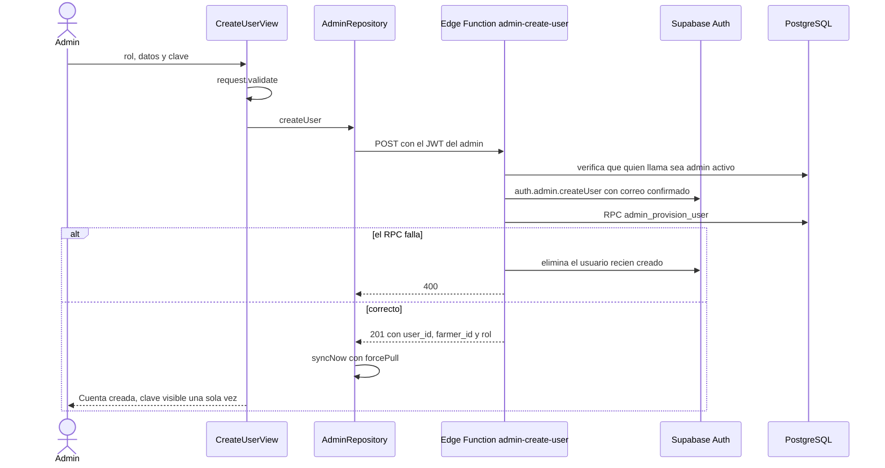

| Rol creado | Identificador | Datos adicionales |
|---|---|---|
| Agricultor | DNI de 8 dígitos | Comunidad, rango de edad |
| Técnico o supervisor | Correo | Zonas |
| Admin | Correo | — |

La clave debe tener 8 caracteres o más, o generarse con "Generar contraseña". La clave de servicio solo existe en la Edge Function, nunca en el cliente.

#### Gestión de un usuario

| Acción | Regla | Destino |
|---|---|---|
| Editar nombre y teléfono | Nombre de 2 caracteres o más | `updateProfile` |
| Cambiar estado | No puede desactivarse a sí mismo | Edge Function `admin-manage-user` (`set_status`) |
| Cambiar contraseña | 8 caracteres o más | Edge Function `admin-manage-user` (`reset_password`) |
| Asignar zonas | — | `setUserZones` |
| Asignar parcelas a un técnico | Solo parcelas de sus zonas | `setTechnicianParcels` |

El rol no se puede cambiar después del alta.

#### Catálogos

El formulario se **genera** a partir de `CatalogDef` y `FieldDef` ([catalog_defs.dart](lib/domain/models/admin/catalog_defs.dart)). Agregar un catálogo nuevo es declararlo ahí, sin escribir una pantalla.

Catálogos definidos: zonas, comunidades, cultivos, tipos de actividad, unidades, productos, síntomas, tipos de poda, categorías y subtipos de asistencia, categorías de gasto, acopiadores, precios de referencia, equivalencias de unidades y configuración.

---

## 10. Flujo crítico de punta a punta

El flujo que define al producto: un problema reportado sin señal llega al técnico, se atiende y se cierra.

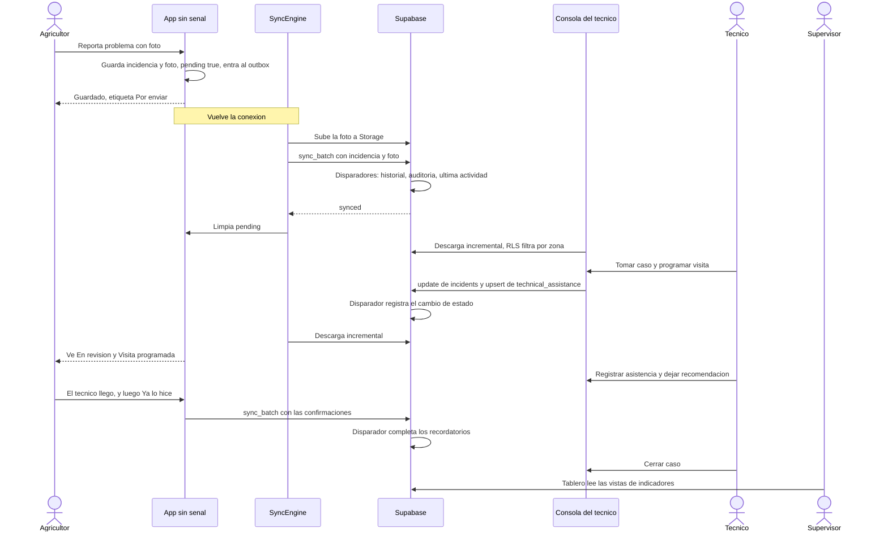

---

## 11. Backend Supabase

Solo existen `supabase/migrations/` y `supabase/functions/`; no hay `config.toml` ni entorno local. Los cambios van directo al proyecto remoto.

### 11.1 Tipos enumerados

| Enum | Valores |
|---|---|
| `user_role` | farmer, technician, supervisor, admin |
| `user_status` | active, inactive, suspended |
| `incident_status` | reported, under_review, visit_scheduled, attended, closed |
| `priority_level` | low, medium, high |
| `assistance_provider` | AIDER, SENASA, OTHER |
| `assistance_status` | scheduled, completed, cancelled |
| `reminder_status` | pending, completed, overdue |
| `unit_category` | weight, volume, container, productive, area, labor, irrigation, other |
| `energy_type` | fuel, electricity, other |
| `residue_destination` | compost, other_use, not_used |
| `adoption_status` | active, low_usage, needs_support, inactive |
| `document_kind` | assistance_photo, external_sheet, other |

### 11.2 Modelo de datos

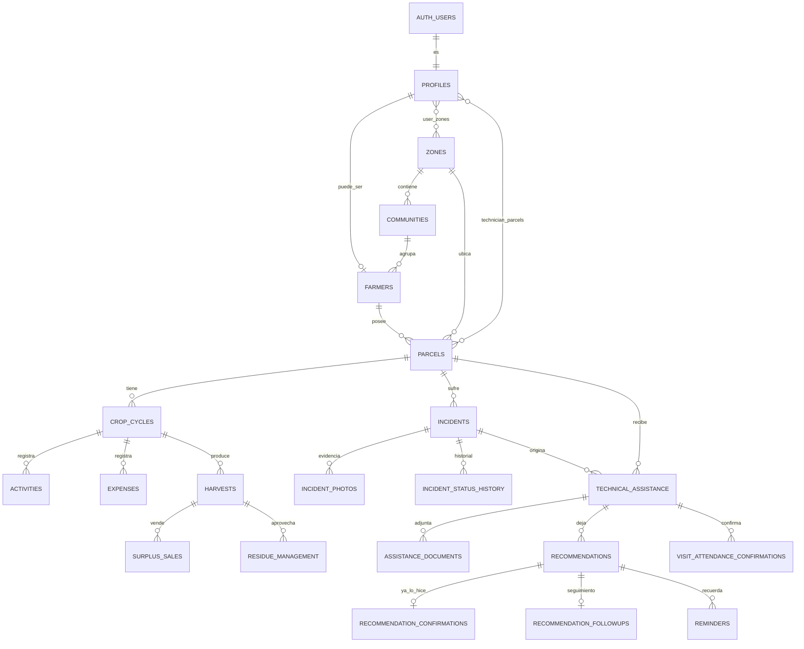

Convenciones del esquema:

- Llaves primarias `uuid`; el cliente genera el id de los registros sin conexión.
- Columnas estándar: `created_at`, `updated_at`, `deleted_at` (borrado lógico).
- Las tablas que nacen sin conexión llevan `device_id`, `created_offline` y `client_created_at`.
- Los catálogos agregan `active` y `sort_order`.

| Grupo | Tablas |
|---|---|
| Catálogos | `zones`, `communities`, `crops`, `units`, `unit_equivalences`, `products`, `product_units`, `activity_types`, `activity_type_units`, `crop_harvest_units`, `pruning_types`, `symptom_types`, `assistance_categories`, `assistance_subtypes`, `expense_categories`, `buyers`, `reference_prices`, `app_settings` |
| Personas y territorio | `profiles`, `user_zones`, `farmers`, `parcels`, `technician_parcels`, `crop_cycles` |
| Operación | `activities`, `expenses`, `incidents`, `incident_photos`, `incident_status_history`, `technical_assistance`, `assistance_documents`, `recommendations`, `recommendation_confirmations`, `recommendation_followups`, `visit_attendance_confirmations`, `reminders`, `harvests`, `surplus_sales`, `residue_management`, `notifications`, `device_tokens` |
| Sistema | `audit_logs`, `sync_log` |

Restricciones de negocio en la base:

| Regla | Dónde |
|---|---|
| Consumo del hogar + excedente ≤ total | `CHECK` en `harvests` |
| Una confirmación por recomendación | `UNIQUE` en `recommendation_confirmations.recommendation_id` |
| Una confirmación de visita por agricultor y asistencia | `UNIQUE` en `visit_attendance_confirmations` |
| DNI de 8 dígitos y único | `CHECK` e índice parcial en `farmers.dni` |
| Geometría como polígono GeoJSON | `CHECK` en `parcels.geometry` |

### 11.3 Funciones y disparadores

| Función | Momento | Efecto |
|---|---|---|
| `set_updated_at` | Antes de actualizar | Mantiene `updated_at` (alimenta el cursor de descarga) |
| `set_incident_closed_at` | Antes de insertar o actualizar `incidents` | Fija o limpia `closed_at` |
| `log_incident_status` | Después de insertar o actualizar `incidents` | Escribe `incident_status_history` |
| `restrict_incident_update` | Antes de actualizar `incidents` | El técnico solo cambia `status`, `priority` y `assigned_technician_id` |
| `touch_farmer_activity` | Después de insertar en tablas de operación | Actualiza `farmers.last_activity_at` |
| `complete_reminders_on_confirmation` | Después de insertar una confirmación | Marca los recordatorios como completados |
| `mark_overdue_reminders` | `pg_cron` diario, si la extensión existe | Pasa recordatorios vencidos a `overdue` |
| `set_harvest_estimated_weight` | Antes de insertar o actualizar `harvests` | Calcula kg solo con equivalencia **validada** |
| `validate_activity_requirements` | Antes de insertar o actualizar `activities` | Exige producto o tipo de poda según el tipo |
| `audit_row_change` | Después de cambios en 6 tablas | Escribe `audit_logs` |

### 11.4 Modelo de seguridad (RLS)

RLS está activado en todas las tablas. Las políticas se apoyan en funciones auxiliares `security definer`:

| Función | Responde |
|---|---|
| `app_role()` | Rol del usuario actual |
| `current_farmer_id()` | Id de agricultor del usuario actual |
| `has_zone_access(zona)` | ¿Tiene acceso a la zona? |
| `can_access_parcel`, `_farmer`, `_cycle`, `_harvest`, `_incident`, `_assistance` | ¿Puede ver ese registro? |
| `can_view_profile(id)` | ¿Puede ver ese perfil? |

Alcance por rol:

| Rol | Ve |
|---|---|
| Agricultor | Solo sus parcelas y lo que cuelga de ellas |
| Técnico | Parcelas de sus zonas o asignadas en `technician_parcels` |
| Supervisor | Parcelas de sus zonas; **si no tiene zonas asignadas, ve todas** |
| Admin | Todo |

Permisos por tabla (roles distintos de admin):

| Tabla | Leer | Insertar | Actualizar |
|---|---|---|---|
| Catálogos | Cualquier autenticado | — | — |
| `profiles` | Propio, o personal con acceso al agricultor | — | Solo la fila propia |
| `parcels` | Según alcance | Agricultor dueño; personal por zona | Igual que insertar |
| `crop_cycles` | Con acceso a la parcela | Con acceso a la parcela | Con acceso a la parcela |
| `activities`, `expenses`, `harvests`, `surplus_sales`, `residue_management`, `incident_photos`, `assistance_documents` | Con acceso al registro padre | Con acceso al registro padre | Ninguno (solo agregar) |
| `incidents` | Con acceso a la parcela | Agricultor dueño; personal por parcela | Técnico y supervisor, columnas limitadas |
| `technical_assistance` | Con acceso a la parcela | Agricultor solo si el proveedor **no** es AIDER; personal por parcela | Técnico y supervisor |
| `recommendations` | Con acceso a la parcela | Técnico y supervisor | Técnico y supervisor |
| `recommendation_confirmations` | Con acceso al agricultor | Con acceso al agricultor | Ninguno |
| `visit_attendance_confirmations` | Con acceso al agricultor | Solo el agricultor dueño | Ninguno |
| `recommendation_followups` | Con acceso al agricultor | Técnico y supervisor, como autor | Igual |
| `audit_logs`, `sync_log` | Supervisor y admin | `sync_log`: fila propia | Ninguno |

Ningún rol distinto de admin puede borrar filas.

### 11.5 Storage

| Bucket | Formatos | Límite |
|---|---|---|
| `incidents` | jpeg, png, webp | 5 MB |
| `assistance` | jpeg, png, webp | 5 MB |
| `external-documents` | jpeg, png, webp, pdf | 5 MB |

Los tres son privados. Las políticas comparan la **primera carpeta** de la ruta con el id del agricultor: el agricultor lee, sube y actualiza lo suyo; el personal lee lo de los agricultores a su alcance. El personal puede subir a `assistance` y `external-documents`, pero no a `incidents`.

### 11.6 Vistas de indicadores

Todas con `security_invoker = true`: respetan el RLS de quien consulta.

| Vista | Contenido |
|---|---|
| `v_kpi_overview` | Por zona: agricultores activos, alertas abiertas, casos atendidos y cerrados, asistencias, horas medias de atención, cumplimiento de recomendaciones |
| `v_zone_summary` | Por zona: productores, alertas abiertas y atendidas |
| `v_technician_workload` | Por técnico: asistencias, casos cerrados y pendientes |
| `v_incident_response_times` | Por incidencia: horas hasta revisión y hasta atención |
| `v_adoption_status` | Por agricultor: estado de adopción según la última actividad |
| `v_crop_cycle_balance` | Por ciclo: gastos, producción por unidad, ingresos por venta, valor referencial de autoconsumo |
| `v_expenses_by_category` | Gastos por zona, cultivo, categoría y mes |
| `v_parcel_timeline` | Línea de tiempo de la parcela |
| `v_recommendation_completion` | Recomendaciones emitidas y confirmadas por zona y técnico |

### 11.7 RPC `sync_batch`

`sync_batch(p_device_id text, p_records jsonb) returns jsonb`, definido en la migración 09 y redefinido en la 14.

| Aspecto | Comportamiento |
|---|---|
| Seguridad | `security invoker`: se aplica el RLS de quien llama |
| Entrada | Lista de `{table, id, client_created_at?, payload}` |
| Lista blanca | Las 11 tablas por lote de la [sección 8.2](#82-tipos-de-operación) |
| Por registro | Fuerza `id`, `device_id` y `created_offline = true`; descarta llaves que no son columnas reales |
| Regla | Rechaza `technical_assistance` con proveedor AIDER |
| Idempotencia | `insert ... on conflict (id) do nothing`; un UUID repetido se reporta igual como `synced` |
| Aislamiento | Cada registro en su propio bloque de excepción: uno que falla no aborta el lote |
| Salida | `{synced: [ids], failed: [{id, error}]}` |
| Registro | Una fila en `sync_log` por llamada |

Es **solo inserción**: no actualiza ni fusiona. `parcels`, `crop_cycles` y `recommendation_followups` no están en la lista blanca y viajan por `upsert` directo.

### 11.8 Edge Functions

Ambas exigen método `POST`, un JWT válido y que quien llama sea `admin` con estado `active`.

| Respuesta | Motivo |
|---|---|
| 401 | Falta la cabecera de autorización o la sesión no es válida |
| 403 | Quien llama no es un admin activo |
| 400 | JSON o datos inválidos |
| 405 | Método distinto de POST |

**`admin-create-user`** — cuerpo: `password`, `full_name`, `role` y, según el rol, `email` o `dni`; opcionales `phone`, `zone_ids`, `community_id`, `age_range`. Responde `201 {ok, user_id, farmer_id, role}`. Si el RPC de provisión falla, elimina el usuario de Auth.

**`admin-manage-user`** — cuerpo: `user_id`, `action` y sus datos.

| Acción | Datos | Efecto |
|---|---|---|
| `reset_password` | `password` de 8 o más | Cambia la clave en Auth |
| `set_status` | `status` | Actualiza `profiles.status` y bloquea o desbloquea en Auth; impide desactivarse a uno mismo |

Devuelve `404` si el usuario no existe.

### 11.9 Migraciones

| Archivo | Contenido |
|---|---|
| `01_enums` | Tipos enumerados y `pgcrypto` |
| `02_catalogs` | Catálogos y sus datos iniciales |
| `03_core_tables` | Personas, territorio, operación y sistema |
| `04_indexes` | Índices, incluidos parciales sobre filas no borradas |
| `05_functions_triggers` | Funciones auxiliares y disparadores |
| `06_rls` | Políticas de seguridad |
| `07_storage` | Buckets y sus políticas |
| `08_views` | Vistas de indicadores |
| `09_sync_rpc` | `sync_batch` |
| `10_seed_demo` | Datos de demostración (opcional) |
| `11_admin_provision_and_hardening` | `admin_provision_user`, políticas de Storage para personal, permisos de ejecución |
| `11_verification` | Consultas de comprobación; sin cambios de esquema |
| `12_admin_user_provisioning` | Otra versión de `admin_provision_user`, con verificación del actor |
| `12_farmer_dni_login` | `farmers.dni` y la versión de `admin_provision_user` que hoy se usa |
| `13_parcel_geometry` | `parcels.geometry` |
| `14_visit_attendance_and_recommendation_marks` | Dos tablas nuevas y ampliación de `sync_batch` |
| `15_parcels_farmer_update_policy` | Política de actualización que el `upsert` necesita |
| `16_parcels_select_and_storage_update` | Lectura de `parcels` con predicados directos; actualización en Storage |
| `17_crop_cycles_farmer_update_and_defaults` | Política de actualización y ciclo activo para parcelas que no tenían |

---

## 12. Aspectos transversales

### Manejo de errores

| Capa | Mecanismo |
|---|---|
| Servicio | Lanza excepciones propias (`AdminServiceException`, `SupervisorServiceException`) o del SDK |
| Repositorio | Las convierte en `Result.error` con un enum de fallo |
| ViewModel | Expone estado de carga, error y dato |
| Vista | Texto en línea, `EmptyState` o aviso flotante |

Enums de fallo: `AuthFailure`, `ParcelFailure`, `RecordFailure`, `IncidentFailure`, `TechnicianFailure`, `AdminFailure`, `LocationFailure`, `LoginIdentifierError`.

### Validación en tres niveles

| Nivel | Ejemplo |
|---|---|
| ViewModel | Área mayor a 0; al menos un síntoma; clave de 8 o más |
| Repositorio | La parcela existe y tiene ciclo; el caso no está cerrado |
| Base de datos | `CHECK`, `UNIQUE`, disparadores y RLS |

La base de datos es la última palabra: un registro que pase el cliente pero viole una regla termina en `failed` y queda en `error` en el outbox.

### Configuración

| Qué | Dónde |
|---|---|
| URL y clave publicable de Supabase | Constantes en [supabase_config.dart](lib/config/supabase_config.dart); no hay `--dart-define` ni `.env` |
| Clave de servicio | Solo en el entorno de las Edge Functions y de `create-admin.mjs` |
| Mapa | [map_config.dart](lib/config/map_config.dart) |
| Umbrales de adopción | Tabla `app_settings` del servidor |

Existe un único entorno: no hay separación entre desarrollo y producción.

### Auditoría y observabilidad

- `audit_logs`: cambios en asistencias, recomendaciones, incidencias, perfiles, parcelas y cosechas.
- `sync_log`: una fila por lote sincronizado, con conteos y errores.
- `outbox.lastError`: motivo del último fallo de cada registro, en el dispositivo.

No se encontró registro de errores ni telemetría del lado del cliente.

### Interfaz

- Textos en español, trato de "usted", escritos directamente en el código (sin `l10n`).
- Código y comentarios en inglés.
- Un solo tema oscuro en verdes con primario lima y botones naranjas ([app_theme.dart](lib/ui/core/theme/app_theme.dart)). Tipografía grande y botones altos (76 px), pensados para el agricultor.

### Componentes compartidos

| Componente | Uso |
|---|---|
| `StepFlowScaffold` | Flujos de una pregunta por pantalla, con atrás, error y capa de "guardando" |
| `FieldMap` | Mapa satelital con contornos de parcelas y pines de incidencias |
| `ThreePanelScaffold` + `AiderSidebar` / `AiderListPanel` / `AiderMainArea` | Marco de la consola |
| `SyncStatusIndicator` | Tarjeta con el estado de envío y "Enviar ahora" |
| `CasePhotoStrip` | Miniaturas: archivo local primero, URL firmada después |
| `StreamViewModel<T>` | Convierte un stream del repositorio en `value` / `isLoading` / `loadFailed` |
| `PendingChip` | Etiqueta "Por enviar" |
| `EmptyState`, `Skeleton*`, `AppLoading*`, `StatusBadge`, `OptionTile`, `PrimaryActionButton` | Estados vacíos, carga y elementos básicos |

---

## 13. Pruebas

La carpeta `test/` refleja `lib/`: 30 archivos de prueba y 4 de dobles.

| Ubicación | Qué prueba |
|---|---|
| `test/data/repositories/` | Repositorios con Drift en memoria |
| `test/data/sync/` | Subida y réplica del `SyncEngine` |
| `test/domain/models/` | Identificador de acceso, parcela, definiciones de catálogo |
| `test/ui/core/widgets/` | Componentes compartidos |
| `test/ui/features/` | ViewModels y vistas de admin, auth, home, login, parcela, técnico y bienvenida |
| `test/testing/` | Dobles reutilizables |

Dobles disponibles: `FakeSyncService`, `FakeConnectivityService`, `FakeAuthService`, `FakeAuthRepository`, `FakeAdminService`, `FakeAdminRepository`, `FakeHomeRepository`, `FakeParcelRepository`, `FakeLocationRepository`, `FakePlaceLookup`, `FakeTechnicianRepository`.

Ninguna prueba toca la red. Sin cobertura propia hoy: incidencias, actividades, cosecha, asistencias y supervisor (vistas).

---

## 14. Ejecución y despliegue

```bash
flutter pub get
```

```bash
flutter analyze
```

```bash
flutter test
```

```bash
flutter run -d chrome
```

```bash
dart run build_runner build --delete-conflicting-outputs
```

| Tema | Detalle |
|---|---|
| Código generado | Ejecutar `build_runner` tras cambiar tablas Drift |
| Web | Requiere `web/drift_worker.js` y `web/sqlite3.wasm` acordes a la versión de `drift` |
| Vista previa | `.claude/launch.json` define `agroapp-web` en el puerto 8123 |
| Primer administrador | `node scripts/create-admin.mjs --email ... --name ...`; requiere `SUPABASE_SERVICE_ROLE_KEY` en el entorno |
| Teléfono físico | `debug_phone.ps1`, `control_phone.ps1`, `abrir_celular.bat` |
| Migraciones | Se aplican a mano sobre el proyecto remoto, en orden alfabético de archivo |

No hay integración continua ni despliegue automatizado en el repositorio.

---

## 15. Decisiones de arquitectura

| Decisión | Motivo | Consecuencia |
|---|---|---|
| Réplica genérica en JSON (`local_records`) | Agregar tablas sin migrar la base local | Los filtros se hacen en Dart, no en SQL; sin tipos en la capa local |
| Escribir primero en el servidor y usar la cola como respaldo | `connectivity_plus` no es confiable en Android | Guardar espera a la red antes de confirmar |
| Dos caminos de subida: RPC por lote y `upsert` directo | Lo que solo se agrega necesita idempotencia; lo editable necesita actualizar | Orden no garantizado entre ambos grupos |
| UUID generado en el cliente | Reintentar sin duplicar | El servidor confía en el id recibido |
| Admin y supervisor solo en línea | Son roles de oficina y sus datos son agregados | No funcionan sin conexión |
| Repositorios por usuario creados en `app.dart` | Dependen del `farmerId` o del técnico | El cableado está repartido en dos archivos |
| Sin enrutador | Bastó para el alcance del MVP | Sin enlaces profundos ni historial del navegador |
| Una consola web dentro de la misma app Flutter | Un solo código y un solo equipo | Se aparta del stack web con React que propone [CONTEXT.md](CONTEXT.md) |
| Seguridad en RLS, no en el cliente | El cliente no es confiable | Toda regla nueva de acceso es una migración |

---

## 16. Guía para una feature nueva

Orden recomendado (de [CONTEXT.md](CONTEXT.md), sección 18.4):

1. **Modelos** en `lib/domain/models/`: inmutables, con su enum de fallo.
2. **Servidor:** migración con tabla, índices, disparador `updated_at` y políticas RLS.
3. **Sincronización:** registrar la tabla en [sync_tables.dart](lib/data/sync/sync_tables.dart).
   - Si solo se agrega: incluirla en `batchTables` **y** en la lista blanca de `sync_batch`.
   - Si se edita: usar `upsert` y crear las políticas de inserción **y** actualización.
4. **Repositorio:** interfaz + `Local*Repository` sobre `LocalStore`, con `watchDerived` para leer.
5. **ViewModel:** `ChangeNotifier` que recibe el repositorio y devuelve `Result`.
6. **Vista:** `StepFlowScaffold` si es un registro del agricultor.
7. **Cableado:** provider en `dependencies.dart` (global) o en el ámbito del rol en `app.dart`.
8. **Pruebas:** repositorio con Drift en memoria y ViewModel con un doble.

### Lista de comprobación

- [ ] La vista no importa nada de `data/services/`.
- [ ] El repositorio no recibe `SupabaseClient`.
- [ ] El id se genera con `_store.newId()` y los padres se guardan antes que los hijos.
- [ ] La tabla tiene `updated_at` con su disparador.
- [ ] Si usa `upsert`, existe política de actualización.
- [ ] Las rutas de archivos empiezan por el `farmerId`.
- [ ] Los errores salen como `Result.error`.
- [ ] Hay un mensaje para "catálogo aún no descargado".

### Errores frecuentes

| Síntoma | Causa probable |
|---|---|
| El registro queda siempre "Por enviar" | Falta la política de actualización, o la tabla no está en la lista blanca de `sync_batch` |
| Error 403 al insertar con `upsert` | La política de lectura usa una función que vuelve a leer la misma tabla (resuelto para `parcels` en la migración 16) |
| El cambio no llega a otros dispositivos | La tabla no actualiza `updated_at`, o no está en `pullTables` |
| La foto no sube | La ruta no empieza por el `farmerId` |
| El hijo falla y el padre sigue en cola | El padre usa `upsert` y el hijo `batch`; se resuelve en el siguiente ciclo |

---

## 17. Deuda técnica y riesgos

### Para revisar antes de producción

| # | Hallazgo | Dónde |
|---|---|---|
| 1 | Contraseñas de demostración en texto plano | `supabase/migrations/10_seed_demo.sql` |
| 2 | Las teselas del mapa se piden a servidores de Google por URL directa, sin clave ni SDK; conviene revisar los términos de uso. [ESTADO_ACTUAL.md](ESTADO_ACTUAL.md) aún dice Esri | [map_config.dart](lib/config/map_config.dart) |
| 3 | Un único entorno; URL y clave fijas en el código | [supabase_config.dart](lib/config/supabase_config.dart) |
| 4 | Las transiciones de estado de una incidencia solo se validan en el cliente | [technician_repository.dart](lib/data/repositories/technician_repository.dart) |
| 5 | La política de `profiles` deja actualizar la fila propia sin restringir columnas | `06_rls.sql` |
| 6 | Un supervisor sin zonas asignadas ve todas las zonas | `has_zone_access` en `05_functions_triggers.sql` |

### Inconsistencias

| Hallazgo | Detalle |
|---|---|
| Migraciones con número repetido | Hay dos `11_` y dos `12_`; el orden real es el alfabético |
| Dos versiones de `admin_provision_user` | La Edge Function y el script usan la de `12_farmer_dni_login`, que **no** verifica al actor ni escribe la auditoría `create_user`. La versión que sí lo hace no se usa |
| Función inexistente | `11_admin_provision_and_hardening.sql` revoca permisos sobre `rls_auto_enable()`, que ninguna migración define; fallaría en una base limpia *(inferido)* |
| Políticas no repetibles | Las de Storage de la migración 11 no tienen `drop policy if exists` |
| Cuentas de demostración | Las cuatro de la semilla no pueden iniciar sesión (detalle en [ESTADO_ACTUAL.md](ESTADO_ACTUAL.md), sección 3.5) |
| Tablas nuevas sin disparadores | `visit_attendance_confirmations` y `recommendation_followups` no auditan ni actualizan la última actividad |

### En el código de la app

| Hallazgo | Detalle |
|---|---|
| Capas que se saltan | `HomeViewModel` recibe `SyncEngine`; cinco archivos de UI importan `data/services/` |
| Excepción al patrón `Result` | `SupervisorRepository.loadDashboard()` lanza excepciones |
| Código sin uso | `StaffHomeView` nunca se instancia; `SyncEngine.syncPending()` no tiene llamadores |
| Pantallas simuladas | Calendario del admin; parte de Reportes; exportar no genera archivo |
| Módulos vacíos | Territorio, Equipo y Reportes del supervisor |
| "Recordarme luego" | Solo muestra un aviso; no programa nada |
| Sin recordatorios locales | La tabla `reminders` se replica, pero no hay notificaciones |
| Subida de archivos en web | `uploadFile` usa `dart:io File`, que no existe en web *(inferido)* |
| Fotos locales | No se borran después de subirlas |
| Sin localización | Todos los textos están escritos en el código |
| Nombre del paquete | Sigue siendo `hackathon`, con `com.example.hackathon` |

### No construido

Gastos como pantalla propia, venta de excedentes independiente, recordatorios, notificaciones del servidor, exportación a Excel, vista territorial y línea de tiempo de la parcela. Las tablas y vistas ya existen en el servidor.

---

## 18. Mantenimiento de este documento

Actualízalo cuando cambie alguno de estos puntos:

| Cambio | Sección |
|---|---|
| Nueva tabla o migración | [8.6](#86-descarga-réplica), [11](#11-backend-supabase) |
| Nueva pantalla o flujo | [7](#7-navegación), [9](#9-flujos-por-rol) |
| Cambio en `LocalStore` o `SyncEngine` | [8](#8-offline-first-y-sincronización) |
| Nuevo provider o servicio | [3](#3-vista-de-capas), [5](#5-arranque-de-la-aplicación) |
| Deuda resuelta | [17](#17-deuda-técnica-y-riesgos) |

Los diagramas son Mermaid: se ven en GitHub y en la vista previa de Markdown de VS Code.
